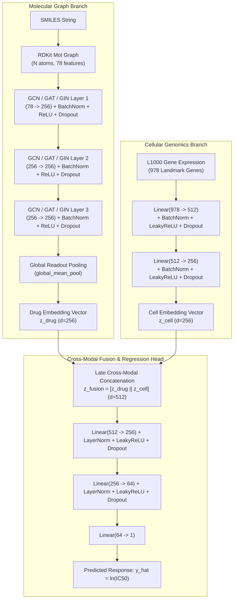

# Prediction of Drug Response in Cancer Cell Lines Using Genomics and Chemical Structures

A production-ready, modular deep learning framework for continuous natural-log half-maximal inhibitory concentration ($\ln \text{IC}_{50}$) regression in cancer cell lines. This framework fuses 2D molecular graph representations with high-dimensional transcriptomic profiles using **PyTorch** and **PyTorch Geometric (PyG)**.

---

## 🔬 Scientific Background & Motivation

Predicting the sensitivity of specific cancer cell lines to candidate pharmacologic agents is a foundational challenge in computational precision oncology. Response variability across tumors stems from complex interactions between the biochemical structure of the drug and the transcriptomic state of the cell:

- **Molecular Chemical Structures**: Drugs are represented as topological 2D molecular graphs where nodes are atoms endowed with 78 physicochemical features (atomic symbol, formal charge, hybridization, degree, aromaticity, hydrogen counts, and radical states) and edges are chemical covalent bonds.
- **Transcriptomic Profiles**: Cellular states are characterized by expression signatures across the **978 L1000 landmark genes** (standardized in the NIH LINCS program, GDSC, and CCLE benchmarks).
- **Target Response**: The continuous natural-log half-maximal inhibitory concentration:
  $$\ln(\text{IC}_{50}) \in \mathbb{R}$$
  where lower values denote greater cellular sensitivity and higher potency.

---

## 🏛️ Model Architecture

The framework implements `MultimodalDrugResponseNet`, a deep dual-branch neural network with late cross-modal fusion:



### Mathematical Formulation

1. **Graph Convolution** (Kipf & Welling GCN formulation):
   $$\mathbf{h}_v^{(l+1)} = \sigma \left( \mathbf{W}^{(l)} \sum_{u \in \mathcal{N}(v) \cup \{v\}} \frac{\mathbf{h}_u^{(l)}}{\sqrt{\tilde{d}_v \tilde{d}_u}} \right)$$
   where $\tilde{d}_v = 1 + \sum_{u \in \mathcal{N}(v)} 1$.

2. **Terminal Molecular Readout**:
   $$\mathbf{z}_{\text{drug}} = \frac{1}{|V|} \sum_{v \in V} \mathbf{h}_v^{(L)} \in \mathbb{R}^{256}$$

3. **Transcriptomic Projection**:
   $$\mathbf{z}_{\text{cell}} = \text{Dropout} \Big( \text{LeakyReLU} \big( \text{BN}(\mathbf{W}_2 \mathbf{h}_1 + \mathbf{b}_2) \big) \Big) \in \mathbb{R}^{256}$$

4. **Cross-Modal Fusion Neck**:
   $$\mathbf{z}_{\text{fusion}} = \left[ \mathbf{z}_{\text{drug}} \,\|\, \mathbf{z}_{\text{cell}} \right] \in \mathbb{R}^{512}$$

5. **Regression Head**:
   $$\widehat{y} = \mathbf{W}_5 \Big( \text{LeakyReLU} \big( \text{LN}(\mathbf{W}_4 \mathbf{h}_3 + \mathbf{b}_4) \big) \Big) + b_5 \in \mathbb{R}$$

---

## 📁 Repository Structure

```
cancer-drug-response/
│
├── data/
│   ├── raw/                   # Raw benchmark downloads (GDSC / CCLE / SMILES)
│   ├── processed/             # Cleaned PyG graphs and normalized tensors
│   └── synthetic/             # Out-of-the-box synthetic benchmark artifacts
│
├── src/
│   ├── __init__.py            # Package root
│   ├── config.py              # Hyperparameters, paths, random seeds, device config
│   ├── dataset.py             # RDKit graph conversion, L1000 filtering, PyG Dataset/DataLoader
│   ├── models/
│   │   ├── __init__.py
│   │   ├── gnn_drug.py        # GCN/GAT/GIN molecular graph branch with global pooling
│   │   ├── mlp_genomics.py    # Deep MLP with BatchNorm, LeakyReLU, and Dropout
│   │   └── multimodal_net.py  # Cross-modal fusion neck and regression head
│   ├── train.py               # Training loop, AdamW optimizer, cosine annealing, early stopping
│   ├── evaluate.py            # PCC, SCC, RMSE, MAE, R2 calculation and test inference
│   └── visualize.py           # Publication-grade diagnostic plots (300 DPI)
│
├── tests/
│   ├── __init__.py
│   ├── test_dataset.py        # Tests graph conversion, tensor shapes, and NaN guards
│   ├── test_models.py         # Tests forward pass, dimension match, and gradient backprop
│   └── test_metrics.py        # Verifies metric edge cases (zero variance, perfect correlation)
│
├── reports/
│   └── figures/               # High-resolution publication plots (300 DPI)
│
├── checkpoints/               # Best model checkpoint (best_model.pt)
├── main.py                    # Unified CLI entrypoint
├── requirements.txt           # Pinned dependencies
├── pytest.ini                 # Pytest configuration
└── README.md                  # Comprehensive framework documentation
```

---

## ⚡ Quick Start

### 1. Installation

Ensure Python 3.10+ is available:

```bash
pip install -r requirements.txt
```

### 2. Run Comprehensive Test Suite

Verify graph parsing, tensor shapes, metric edge cases, and dual-branch gradient backpropagation:

```bash
pytest
```

Output:
```
============================= test session starts =============================
collected 21 items

tests\test_dataset.py ........                                           [ 38%]
tests\test_metrics.py .....                                              [ 61%]
tests\test_models.py ........                                            [100%]

============================= 21 passed in 6.35s ==============================
```

### 3. Run End-to-End Demo

Execute the complete end-to-end pipeline: synthesizes 1,200 (drug, cell) pairs across 60 oncology drugs and 40 cell lines, partitions into 80/10/10 splits, trains for 20 epochs, evaluates on the test split, and exports all 4 publication figures:

```bash
python main.py --mode demo
```

---

## 📊 Publication-Grade Diagnostic Figures

The framework automatically renders four 300 DPI figures to `reports/figures/`:

1. **`learning_curves.png`**:
   - Training vs. Validation MSE loss dynamics across epochs.
   - Highlights the best validation checkpoint epoch.
2. **`predicted_vs_actual.png`**:
   - Parity plot comparing actual vs. predicted $\ln(\text{IC}_{50})$.
   - 45-degree dashed equality line ($y = \widehat{y}$) and linear regression trendline with 95% confidence intervals.
   - Dynamic annotation box displaying Pearson $r$ (PCC), Spearman $\rho$ (SCC), RMSE, and $R^2$.
3. **`residuals_distribution.png`**:
   - Histogram and Kernel Density Estimate (KDE) of prediction errors ($y - \widehat{y}$).
   - Verifies normal residual dispersion with mean error ($\mu$) and standard deviation ($\sigma$).
4. **`latent_space_tsne.png`**:
   - 2D t-SNE manifold projection of the 512-dimensional multimodal latent space.
   - Colored by continuous $\ln(\text{IC}_{50})$ sensitivity gradient.

---

## ⚙️ CLI Options

| Argument | Type | Default | Description |
| :--- | :---: | :---: | :--- |
| `--mode` | `str` | `demo` | Execution mode: `demo`, `train`, `eval`, `synthesize` |
| `--epochs` | `int` | `20` (demo) / `100` | Number of training epochs |
| `--batch_size` | `int` | `64` | Mini-batch size for DataLoader |
| `--lr` | `float` | `1e-4` | Initial learning rate for AdamW |
| `--weight_decay`| `float` | `1e-5` | L2 weight decay penalty |
| `--gnn_type` | `str` | `gcn` | Graph backbone: `gcn`, `gat`, or `gin` |
| `--device` | `str` | `auto` | Compute device: `auto`, `cuda`, `mps`, or `cpu` |
| `--seed` | `int` | `42` | Random seed for full reproducibility |
| `--num_samples`| `int` | `1200` | Number of response pairs in synthetic benchmark |

---

## 🧪 Evaluation Metrics Defined

- **Root Mean Squared Error (RMSE)**:
  $$\text{RMSE} = \sqrt{\frac{1}{N} \sum_{i=1}^N (y_i - \widehat{y}_i)^2}$$
- **Mean Absolute Error (MAE)**:
  $$\text{MAE} = \frac{1}{N} \sum_{i=1}^N |y_i - \widehat{y}_i|$$
- **Pearson Correlation Coefficient (PCC)**:
  $$r = \frac{\sum (y_i - \bar{y})(\widehat{y}_i - \bar{\widehat{y}})}{\sqrt{\sum (y_i - \bar{y})^2 \sum (\widehat{y}_i - \bar{\widehat{y}})^2}}$$
- **Spearman Rank Correlation (SCC)**:
  $$\rho = 1 - \frac{6 \sum d_i^2}{N(N^2 - 1)}$$
- **Coefficient of Determination ($R^2$)**:
  $$R^2 = 1 - \frac{\sum (y_i - \widehat{y}_i)^2}{\sum (y_i - \bar{y})^2}$$
